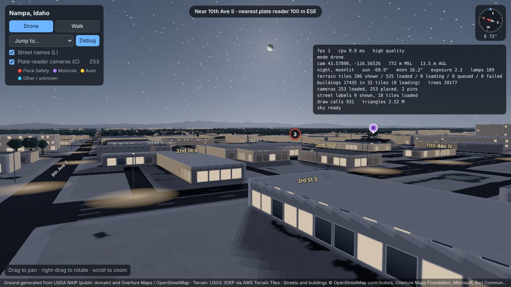

# Nampa 3D viewer

A browser 3D view of Nampa, Idaho, with real terrain, imagery, buildings and
street names, plus an overlay of the publicly mapped automated license plate
reader (ALPR) cameras in the Treasure Valley, such as Flock Safety's.
It is a static site: everything runs in the browser, with no server code.

**Live:** https://saxton-network.github.io/nampa-weather/

The repository name dates from the original plan, a simulated local-weather
overlay. That plan is parked; the camera overlay replaced it.

## What's in it

| Piece | Source | Notes |
|---|---|---|
| Ground | Generated. Ground types are classified from USDA NAIP aerial photos (public domain) and corrected with Overture water, land use and land cover | `public/tiles/landcover/`: one ground type per pixel (lawn, trees, dry scrub, dirt, asphalt, concrete, water, crops, plowed field, sand, pool) at about 0.9 m (z17) over Nampa, 7 m across the Treasure Valley, 38 m out to the mountains. A shader paints each type with procedural detail that stays sharp up close. The photos themselves are not shipped |
| Roads on the ground | Overture transportation (OpenStreetMap) | Every road, driveway, parking aisle, alley and path is painted into the ground at a width set by its type, with sidewalks, yellow centre lines and white edge and lane lines |
| Trees | USGS 3DEP lidar (2018 Southern Idaho survey, public domain) | Each tree is a canopy peak found in the lidar point cloud, with its measured height and crown width; tall narrow crowns become conifers. Low-poly crowns on separate trunks in `public/data/trees/`. Drawn within about 1 km below 600 m altitude |
| Terrain | [AWS Terrain Tiles](https://registry.opendata.aws/terrain-tiles/) (terrarium encoding, USGS 3DEP) | Snapshot saved in `public/tiles/elevation/`: about 3.5 m (z15) over Nampa, coarser beyond. Streamed as a quadtree with Earth curvature built in. Land with no cameras and few buildings is drawn a level or two coarser (except right around the viewer), and terrain past 40 km (25 km with `quality=low`) stays coarse, where haze hides detail anyway |
| Buildings | [Overture Maps](https://overturemaps.org/) buildings, release 2026-10-21.0, refined near cameras from USGS lidar and NAIP photos | 77,803 buildings, pre-cut into 1 km tiles in `public/data/buildings/`, meshed in a Web Worker. Within a mile of a plate-reader camera, every building gets its roof colour from the aerial photo, and where lidar exists (southwest Nampa for now, 11,080 buildings) its footprint is lined up with the lidar, its eave and ridge heights are measured, and its roof is fitted: flat, gabled or hipped, with L- and T-shaped houses split into cross-gabled wings. Elsewhere houses get a guessed gable or hip roof |
| Street names | Overture Maps transportation (from OpenStreetMap) | 12,070 named road segments in `public/data/roads/`. Labels follow the roads in drone mode, stand at sign height in walk mode, and are hidden when a building blocks the view |
| ALPR cameras | OpenStreetMap nodes tagged `surveillance:type=ALPR`, mapped by the [DeFlock](https://deflock.org) community | 253 cameras across the Treasure Valley in `public/data/cameras.json`, refreshed on every deploy and daily. Each camera gets a pole, a head per direction it faces and a translucent ground wedge showing what it points at, coloured by brand. Clickable pins cluster when zoomed out |
| Facades | Generated from each building's Overture type and height | Walls get windows, doors and shopfronts from the building's type and height, drawn by a shader so they cost no geometry |
| Shadows | Shadow map from the sun, or the moon at night | Buildings and trees cast shadows on the ground, walls and each other within a box around the view |
| Sky and light | [`@takram/three-atmosphere`](https://github.com/takram-design-engineering/three-geospatial) and `src/night.js` | Frozen at Halloween night, 1:30 am on Nov 1 2026 (`snapshot.time` in `src/region.json`), after moonrise. The real 58%-lit waning gibbous moon, about 16° up in the east-northeast, lights the scene and casts the shadows; the moon disc shows its true phase, with stars, a cool night grade, lit windows and street lights |
| Street lights | Placed by rule from the street network | No public street-light map exists for Nampa, so lamps go where cities usually put them: a corner of every public intersection (both corners where an arterial crosses), the end of residential dead ends, and mid-block on long blocks (every 45–95 m by road type), only in built-up areas. Pools of light are painted into the ground |
| Engine | three.js 0.186 + postprocessing | Logarithmic depth buffer, SMAA |

**The scene is a frozen moment with its own look: Halloween night, lit by the moon.** Nothing photographic is
shown: the ground, roads and trees are generated from what the aerial photos,
lidar and map data say is there. Ground maps, terrain, buildings, streets and trees
are all saved in the site itself, and the lighting never changes, so a
visitor's browser makes no requests to outside servers. Only the camera
locations are refreshed, at build time.



## Using it

- **Drone mode (default):** drag to pan, right-drag (or two fingers) to rotate, scroll to zoom toward the cursor.
- **Walk mode:** press **V** or click *Walk*. Click to capture the mouse, then WASD or the arrow keys to walk, Shift to run and Space to jump; buildings are solid. Esc releases the mouse. On touch screens, drag to look and hold ▲ ▼ to walk.
- **Plate-reader cameras:** click a pin for its brand, facing direction(s), mount, operator and last edit, with *Fly to*, *Look from here* (walk mode at the pole, facing where the camera looks) and a link to the OpenStreetMap node. Numbered pins are clusters; click one to zoom in. Press **C** to show or hide the overlay. The top pill shows the nearest camera's distance and direction.
- **Compass** (top right): the red needle points north and the readout shows which way you are facing. Click it or press **N** to turn and face north.
- **Street names:** press **L** or use the checkbox to show or hide them. The pill at the top shows the street you are on (walk mode) or the one under the view's centre (drone mode).
- **Debug panel:** press **`** or click *Debug*. It shows FPS, camera position, tile counts, draw calls and errors. A screenshot of this panel is the most useful thing to send when something looks wrong.

URL parameters, handy for sharing a view:

| Parameter | Meaning |
|---|---|
| `view` | Camera preset: `overview`, `downtown`, `neighborhood`, `street`, `mountains` |
| `quality` | `low` or `high` (default is `low` on touch devices) |
| `exposure` | Tone-mapping exposure (default 2.2 at night, 10 by day) |
| `time` | Override the frozen moment (ISO 8601), e.g. `time=2026-07-15T23:30:00Z` for a summer evening; daylight and night lighting switch automatically |
| `labels` | `0` hides street names |
| `cameras` | `0` hides the plate-reader cameras |
| `at` | `lat,lon[,distance,heading,pitch]`: open a drone view of any spot, e.g. `at=43.5797,-116.5622,150,45,-25` |
| `camera` | An OpenStreetMap node id: fly to that camera and open its card |
| `debug` | Open the debug panel |

## Running locally

Needs [Node.js](https://nodejs.org/) 20 or newer.

```sh
npm install
npm run dev        # http://localhost:5173 with live reload
npm run build      # static site in dist/, deployable to any web server
```

`dist/` uses relative paths, so it works from a subfolder or its own subdomain.

## Rebuilding the map data

```sh
python3 -I data-prep/build_cameras.py     # public/data/cameras.json
python3 -I data-prep/build_snapshot.py    # elevation + NAIP photos (photos stay in data-prep/.cache)
python3 -I data-prep/build_trees_lidar.py # public/data/trees/ (+ canopy heights in data-prep/.cache)
python3 -I data-prep/build_buildings.py   # public/data/buildings/ (uses the cameras and both caches)
python3 -I data-prep/build_roads.py       # public/data/roads/ (uses the buildings for street lights)
python3 -I data-prep/build_landcover.py   # public/tiles/landcover/, coverage.json
```

The scripts need `pip install numpy pillow pyarrow`; the lidar step also needs
`pip install laspy lazrs pyproj`.

`build_snapshot.py` exports NAIP from the USGS image service in blocks of up
to 3,840 px (splitting a block when the service times out) and cuts them into
tiles in `data-prep/.cache/naip-tiles/`, and re-encodes the AWS elevation tiles
as lossless WebP in `public/tiles/elevation/` (heights rounded to 1/8 m). Which
zooms cover which area is set by `snapshot` in `src/region.json`. A full run can
take an hour when the USGS service is busy, and can be restarted where it stopped.

`build_landcover.py` sorts every photo pixel into a ground type by colour and
local texture, using Overture land cover to tell town from fields and natural
ground, burns in Overture water, canals, pools, farmland and golf features,
fills shadows from their surroundings, and clears photographed asphalt along
roads the viewer paints itself. Where lidar canopy heights are cached, it marks
green ground under real canopy as trees and clears "trees" with nothing
standing on them. It writes
`public/tiles/coverage.json`, which tells the viewer which tiles exist.

`build_trees_lidar.py` streams the USGS 3DEP point cloud for the Nampa area
(`ID_SouthernID_21_2018` in the public `usgs-lidar-public` bucket, about 800
million points) and keeps the highest and lowest return per 0.9 m pixel. It
subtracts the ground to get canopy height, masks building footprints, and finds
tree tops as local height peaks; each crown's width comes from how far the
canopy around the peak stays above half its height. It takes about an hour.
Run it before `build_landcover.py`, which uses its cached canopy heights.

`build_buildings.py` measures the buildings within a mile of a camera with
`building_detail.py`. It needs the lidar canopy heights (which include roofs)
and the NAIP photo tiles cached by the two steps before it; without them it
writes the map data as is. Each footprint is slid up to 2.5 m to best match
the lidar, then split into rectangles if it is right-angled (L, T and U
shapes). Each rectangle is fitted with flat, gabled and hipped roofs of free
eave height and pitch, ignoring trees that overhang it, and the best fit is
kept. Houses lean towards pitched roofs. The roof colour is the photo's
median colour inside the footprint, leaving out anything green.

`build_cameras.py` uses only the standard library. It reads the nationwide feed
behind [DeFlock's map](https://maps.deflock.org) (built from OpenStreetMap) and
keeps the cameras inside `cameraBbox` in `src/region.json`.

These need Python 3 with `pyarrow`, `numpy` and `Pillow`. They read Overture
GeoParquet anonymously from S3 and sample ground height from the same terrain
tiles the viewer uses (cached in `data-prep/.cache/`). Shared geodesy and
terrain code lives in `data-prep/common.py`. The area and
origin are set in `src/region.json`. Set `OVERTURE_RELEASE` to use a newer
Overture release.

## Screenshots without a GPU

`tools/screenshot.mjs` renders preset views in headless Chromium with software
WebGL. Frame rates there mean nothing; use it to check that the scene renders.

```sh
npm run build && npx vite preview --port 4173 &
node tools/screenshot.mjs screenshots overview downtown street
```

## Known limits

- **The ground types are automatic guesses.** The classifier reads colour and texture only, so some roofs, shadows and dry lawns land in the wrong type, and ground-type edges are only as fine as the 0.9 m photos. Roads, which come from map data, are exact.
- **No collisions in walk mode.** You can walk through buildings.
- **The moon is drawn larger than life** (about 2.5x) so it reads on screen, and the stars are a generated field, not real constellations.
- **Building heights are mostly machine-learning estimates** from Overture/Microsoft, and the roof shapes are guesses for houses.
- **The ground is a snapshot.** It reflects whenever NAIP last flew Idaho, and new construction since then is missing. Rerun the two snapshot scripts to refresh it.
- **The camera map is crowd-sourced.** Cameras that nobody has mapped are missing, and the wedges are a fixed 30 m long and 40° wide, an approximation of what a plate reader covers.
- **Mobile is untested on real hardware.** Touch devices default to `quality=low` (fewer tiles, lower pixel ratio).

## Credits

Ground generated from USDA NAIP via USGS The National Map (public domain) ·
Terrain: USGS 3DEP via AWS Terrain Tiles ·
Trees: USGS 3DEP lidar (public domain) ·
Buildings © Overture Maps Foundation, © OpenStreetMap contributors, Microsoft, Esri Community Maps ·
ALPR locations © OpenStreetMap contributors, mapped by the DeFlock community ·
Atmosphere: takram three-geospatial (MIT).

**Data license.** The camera locations are OpenStreetMap data (ODbL 1.0).
The building and street tiles in `public/data/` are derived from
Overture Maps data. They are redistributed under the same terms:
[ODbL 1.0](https://opendatacommons.org/licenses/odbl/1-0/) for parts derived from
OpenStreetMap and [CDLA-Permissive-2.0](https://cdla.dev/permissive-2-0/) for the rest.

## Hosting

`.github/workflows/deploy-pages.yml` builds the site and publishes it to GitHub
Pages on every push to `main` and once a day. Each build first refreshes the
camera locations; if that download fails, the committed snapshot is used.
GitHub pauses scheduled runs in a repository with no activity for 60 days;
re-enable it from the Actions tab if that happens. In the repository, set Settings → Pages →
Source to **GitHub Actions** once.
