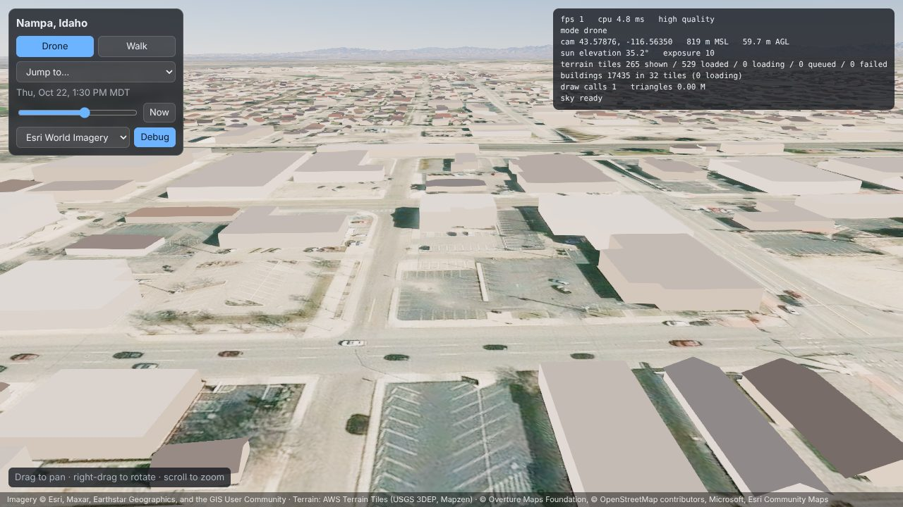

# Nampa weather viewer

A browser 3D view of Nampa, Idaho, heading toward a live weather simulation:
real radar, wind and cloud data driving rain, snow, fog, clouds and lightning.
It is a static site: everything runs in the browser, with no server code.

**Live:** https://saxton-network.github.io/nampa-weather/

**Status: Phase 1** (terrain, imagery, buildings, camera, sky). Radar and weather come next.

## What's in it

| Piece | Source | Notes |
|---|---|---|
| Terrain | [AWS Terrain Tiles](https://registry.opendata.aws/terrain-tiles/) (terrarium PNG, USGS 3DEP in the US) | Streamed quadtree, elevation to z15 (about 3.5 m), with Earth curvature built in |
| Imagery | Esri World Imagery (default, to z19, about 0.2 m) or USGS National Map / NAIP (to z16) | Switchable in the panel |
| Buildings | [Overture Maps](https://overturemaps.org/) buildings, release 2026-10-21.0 | 77,803 buildings, pre-cut into 1 km tiles in `public/data/buildings/`, meshed in a Web Worker. Houses get gable or hip roofs |
| Sky and light | [`@takram/three-atmosphere`](https://github.com/takram-design-engineering/three-geospatial) | Physically based sky, sun and moon for the real date and time, plus aerial haze |
| Engine | three.js 0.186 + postprocessing | Logarithmic depth buffer, SMAA |

The heavy data (terrain and imagery) streams from public tile servers. Only the
building tiles (7.3 MB) are shipped with the site.



## Using it

- **Drone mode (default):** drag to pan, right-drag (or two fingers) to rotate, scroll to zoom toward the cursor.
- **Walk mode:** press **V** or click *Walk*. Click to capture the mouse, use WASD or the arrow keys to walk, and hold Shift to run. Esc releases the mouse. On touch screens, drag to look and hold ▲ ▼ to walk.
- **Time slider:** sets the time of day in Boise time. *Now* returns to real time.
- **Debug panel:** press **`** or click *Debug*. It shows FPS, camera position, tile counts, draw calls and errors. A screenshot of this panel is the most useful thing to send when something looks wrong.

URL parameters, handy for sharing a view:

| Parameter | Meaning |
|---|---|
| `view` | Camera preset: `overview`, `downtown`, `neighborhood`, `street`, `mountains` |
| `t` | Time as ISO 8601, e.g. `t=2026-10-22T19:30:00Z` |
| `imagery` | `esri` or `usgs` |
| `quality` | `low` or `high` (default is `low` on touch devices) |
| `exposure` | Tone-mapping exposure (default 10) |
| `debug` | Open the debug panel |

## Running locally

Needs [Node.js](https://nodejs.org/) 20 or newer.

```sh
npm install
npm run dev        # http://localhost:5173 with live reload
npm run build      # static site in dist/, deployable to any web server
```

`dist/` uses relative paths, so it works from a subfolder or its own subdomain.

## Rebuilding the building data

```sh
python3 -I data-prep/build_buildings.py
```

This needs Python 3 with `pyarrow`, `numpy` and `Pillow`. It reads Overture
GeoParquet anonymously from S3, samples ground height from the same terrain
tiles the viewer uses, and rewrites `public/data/buildings/`. The area and
origin are set in `src/region.json`. Set `OVERTURE_RELEASE` to use a newer
Overture release.

## Screenshots without a GPU

`tools/screenshot.mjs` renders preset views in headless Chromium with software
WebGL. Frame rates there mean nothing; use it to check that the scene renders.

```sh
npm run build && npx vite preview --port 4173 &
node tools/screenshot.mjs screenshots overview downtown street
```

## Known limits (Phase 1)

- **Eye level is blurry.** Aerial imagery is about 0.2–0.3 m per pixel, so the ground smears when seen from 1.7 m. Procedural ground detail and lidar trees are Phase 5.
- **No collisions in walk mode.** You can walk through buildings.
- **No shadows.** The imagery has its own baked-in shadows; buildings cast none yet.
- **Building heights are mostly machine-learning estimates** from Overture/Microsoft, and the roof shapes are guesses for houses.
- **Esri imagery terms.** The public Esri endpoint is used for this personal, non-commercial project. For anything beyond that, switch to an ArcGIS Location Platform key or the USGS imagery.
- **Mobile is untested on real hardware.** Touch devices default to `quality=low` (fewer tiles, lower pixel ratio).

## Credits

Imagery © Esri, Maxar, Earthstar Geographics, and the GIS User Community ·
USGS The National Map / USDA NAIP · Terrain: AWS Terrain Tiles (USGS 3DEP, Mapzen) ·
Buildings © Overture Maps Foundation, © OpenStreetMap contributors, Microsoft, Esri Community Maps ·
Atmosphere: takram three-geospatial (MIT).

**Data license.** The building tiles in `public/data/buildings/` are derived from
Overture Maps buildings. They are redistributed under the same terms:
[ODbL 1.0](https://opendatacommons.org/licenses/odbl/1-0/) for parts derived from
OpenStreetMap and [CDLA-Permissive-2.0](https://cdla.dev/permissive-2-0/) for the rest.

## Hosting

`.github/workflows/deploy-pages.yml` builds the site and publishes it to GitHub
Pages on every push to `main`. In the repository, set Settings → Pages →
Source to **GitHub Actions** once.
